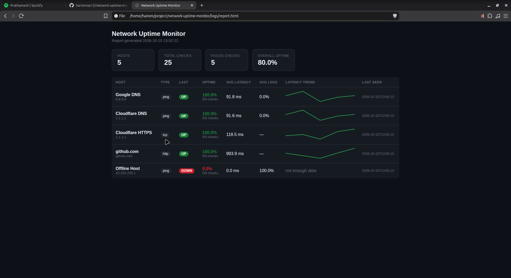

# 🌐 Automated Network Uptime Monitor with Alert System


A lightweight, self-hosted uptime monitor written in Python. It checks a list of
hosts on a schedule — **ICMP ping**, **TCP port**, or **HTTP(S)** — records
**latency** and **packet loss** to disk, and fires **Email / Telegram alerts**
the moment a host goes **DOWN**, plus a recovery alert when it comes back **UP**.

Designed to run quietly in the background on a Linux box (NOC / home-lab /
VPS) via **cron**, a **systemd** service, or **Docker**.

---

## 📖 Overview

Poor man's UptimeRobot, but fully yours. No SaaS, no dashboard lock-in — just a
script you own, a config file, and alerts that reach you where you already are
(Telegram / Email).

**Why it matters:** a NOC + dev combo — the exact "monitoring mindset" that
network operations roles look for, demonstrated in a small, real, deployable tool.

---

## 📸 Screenshot



*`report.py` turns the metrics CSV into a standalone HTML status page: an overall
uptime summary, per-host status badges, average latency and **latency sparklines** —
no server or SaaS required.*

---

## ✨ Features

- 🔁 **Multi-host monitoring** — check any number of hosts **in parallel** (thread
  pool), each with its own interval.
- 🧪 **Three check types** — **ICMP ping**, **TCP port** and **HTTP(S)** (with
  expected status code), configured per host.
- 📉 **Latency & packet-loss tracking** — records RTT and loss % per round.
- 🗂️ **File logging** — rotating application log + a CSV time-series for later analysis.
- 🚨 **Smart alerting** — Email (SMTP) and Telegram, with **DOWN → UP** state
  tracking so you get *one* alert per incident, not a message every second.
- 💾 **Persistent state** — remembers which hosts were DOWN, so restarting the
  service does **not** re-send alerts.
- 🔔 **Cooldown / re-notify** — optionally re-alert every N minutes while a host
  stays down.
- 📊 **HTML report** — `report.py` turns the metrics CSV into a standalone status
  page with uptime % and latency sparklines.
- ⏱️ **Flexible scheduling** — run with `cron` / `systemd`, or in-app per-host intervals.
- 🐳 **One-command deploy** — Dockerfile + `docker-compose.yml` and an `install.sh`
  systemd installer.
- ⚙️ **Config-driven** — hosts, intervals, thresholds and channels live in `config.yaml`.
- 🔐 **Secrets kept out of git** — all credentials are loaded from `.env`.
- 🧪 **Tested** — 42 unit tests, wired into GitHub Actions CI.

---

## 🧰 Tech Stack

| Layer            | Technology                          |
| ---------------- | ----------------------------------- |
| Language         | Python 3.10+                        |
| ICMP / ping      | [`icmplib`](https://pypi.org/project/icmplib/) |
| TCP / HTTP checks| `socket`, `requests`                |
| Config / secrets | `PyYAML`, `python-dotenv`           |
| Scheduling       | Cron / systemd (per-host intervals) |
| Alerts           | SMTP (`smtplib`) + Telegram Bot API |
| Output           | `logging`, CSV, HTML report         |
| Packaging        | Docker / Docker Compose, systemd    |
| Tests            | `pytest`                            |
| Platform         | Linux                               |

---

## 🗂️ Project Structure

```
network-uptime-monitor/
├── monitor.py              # entry point: load config -> check -> log -> alert
├── report.py               # build an HTML uptime report from the metrics CSV
├── config.yaml             # hosts, intervals, thresholds, alert toggles
├── .env.example            # template for secrets  (copy to .env)
├── requirements.txt        # pinned Python dependencies
├── Dockerfile              # container image
├── docker-compose.yml      # one-command deployment
├── install.sh / uninstall.sh  # systemd service installer
├── src/
│   ├── __init__.py
│   ├── config.py           # load & validate config.yaml + .env
│   ├── checks.py           # ICMP / TCP / HTTP checks -> CheckResult
│   ├── logger.py           # rotating log + CSV metrics writer
│   ├── state.py            # JSON state store (survives restarts)
│   ├── alerts.py           # Email (SMTP) & Telegram senders + state tracking
│   └── report.py           # HTML report renderer
├── tests/                  # pytest unit tests
├── logs/                   # generated logs & metrics (git-ignored)
├── docs/                   # screenshots used in this README
├── .gitignore
├── LICENSE
└── README.md
```

## 🧩 How It Works (file by file)

| File | Responsibility |
| --- | --- |
| **`monitor.py`** | Entry point / orchestrator. Parses CLI args, loads the config, then in a loop: check each host → write metrics → raise alerts if state changed. `--once` runs a single cycle (cron-friendly); the default is continuous (systemd). |
| **`src/config.py`** | Reads `config.yaml` + `.env`, merges per-host values over `defaults`, and returns validated dataclasses (`Host`, `LoggingConfig`, `AlertConfig`, `StateConfig`). |
| **`src/checks.py`** | Runs the check matching `host.kind` — **ICMP** (`icmplib`), **TCP** (`socket`) or **HTTP** (`requests`) — and normalises everything into a `CheckResult` (`is_alive`, latency, packet-loss %, detail). Never raises. |
| **`src/logger.py`** | `setup_logger()` builds a rotating file + console logger; `MetricsWriter` appends one CSV row per check for the time-series. |
| **`src/state.py`** | `StateStore` persists each host's last state (JSON) so a restart doesn't re-fire alerts, and remembers when the last alert was sent (for cooldown). |
| **`src/alerts.py`** | Telegram & Email channels plus the `AlertManager`, which remembers each host's last state so you get **one** DOWN alert and **one** RECOVERY alert per incident — plus optional re-notify while down. |
| **`src/report.py`** | Turns the metrics CSV into a standalone HTML status page (uptime %, latency sparklines, last status). |
| **`config.yaml`** | What to monitor and how (hosts, check types, intervals, thresholds, channels). |
| **`.env`** | Secrets only (Telegram token, SMTP credentials). Never committed. |

### Flow of a single check

```
monitor.py
└─ config.load_config()               # config.yaml + .env
└─ for each host (respecting its interval):
     ├─ checks.run_check()            # ping | tcp | http -> CheckResult
     ├─ logger.MetricsWriter.write()  #                -> logs/metrics.csv
     └─ alerts.AlertManager.evaluate()# state change?  -> Telegram / Email
```

### Alert behaviour

- A host must fail **`retries` consecutive rounds** before it is considered DOWN
  (prevents a single lost packet from paging you).
- One **DOWN** alert per outage; one **RECOVERED** alert when it returns
  (disable recovery alerts per host with `alert_recovery: false`).
- A host that is **already down** when the monitor starts still triggers a DOWN
  alert (unknown hosts are assumed UP on first sight).
- Host state is **persisted** to `logs/state.json`, so restarting the service does
  not repeat alerts for hosts that were already down.
- Set `renotify_minutes` on a host (or in `defaults`) to get a **re-notify** while
  it stays down — e.g. `renotify_minutes: 30`.

---

## ✅ Prerequisites

- Linux (tested on Linux Mint / Ubuntu / Debian)
- Python **3.10+**
- `ping` utility (`iputils-ping`)
- `cron` (for scheduled runs)
- Root / `CAP_NET_RAW` for raw ICMP sockets (see note below)

---

## 🚀 Installation

```bash
# 1. Clone
git clone https://github.com/hariomop12/network-uptime-monitor.git
cd network-uptime-monitor

# 2. System packages (Debian / Ubuntu / Mint)
sudo apt update
sudo apt install -y python3 python3-pip python3-venv iputils-ping cron

# 3. Virtual environment
python3 -m venv .venv
source .venv/bin/activate

# 4. Python dependencies
pip install -r requirements.txt
```

### 🔑 ICMP permissions (important)

`icmplib` uses raw sockets, which normally need root. Instead of running the
whole script with `sudo`, grant the capability once to the interpreter:

```bash
# Option A: run with sudo
sudo ./.venv/bin/python monitor.py

# Option B (cleaner): grant CAP_NET_RAW to the venv interpreter
sudo setcap cap_net_raw+ep .venv/bin/python3
```

---

## ⚙️ Configuration

### `config.yaml`

Controls **what** is monitored and **how**:

- `defaults` — global interval, timeout, retries, recovery + re-notify alerts
- `logging` — log directory, rotation size, CSV file name, log level
- `state` — where to persist host state across restarts (`enabled`, `file`)
- `alerts` — enable/disable Email and Telegram channels
- `hosts` — the list of hosts, each optionally overriding defaults

Each host can be an ICMP ping, a TCP port check, or an HTTP request:

```yaml
hosts:
  # ICMP ping (default)
  - name: Google DNS
    address: 8.8.8.8
    interval: 30

  # TCP port check
  - name: SSH
    address: 10.0.0.5
    type: tcp
    port: 22

  # HTTP check (expect 200)
  - name: Public site
    address: example.com
    type: http
    url: https://example.com
    expect_status: 200
```

Host fields: `type` (`ping` \| `tcp` \| `http`), `port`, `url`, `expect_status`,
`interval`, `timeout`, `count` (ping), `retries`, `alert_recovery`, `renotify_minutes`.

### `.env` (secrets)

Never stored in `config.yaml`. Copy the template and fill it in:

```bash
cp .env.example .env
```

| Variable             | Purpose                                  |
| -------------------- | ---------------------------------------- |
| `TELEGRAM_BOT_TOKEN` | Bot token from [@BotFather](https://t.me/BotFather) |
| `TELEGRAM_CHAT_ID`   | Your chat/group id (from `getUpdates`)   |
| `SMTP_HOST` / `SMTP_PORT` | SMTP server for email alerts        |
| `SMTP_USER` / `SMTP_PASSWORD` | SMTP login (Gmail → App Password) |
| `ALERT_EMAIL_TO`     | Recipient address for alerts             |

---

## 🔔 Alert Setup

### Telegram

1. Open Telegram → chat with **@BotFather** → `/newbot` → copy the **token**.
2. Put it in `.env` as `TELEGRAM_BOT_TOKEN`.
3. Send your bot any message, then open
   `https://api.telegram.org/bot<TOKEN>/getUpdates` and copy `chat.id`
   into `TELEGRAM_CHAT_ID`.
4. Set `alerts.telegram.enabled: true` in `config.yaml`.
5. Verify: `sudo ./.venv/bin/python monitor.py --test-alert` — you should get a
   message on Telegram.

### Email (SMTP)

1. For Gmail: enable 2-Step Verification → **App passwords** → generate one.
2. Fill `SMTP_*` and `ALERT_EMAIL_TO` in `.env`.
3. Set `alerts.email.enabled: true` and `to_addrs` in `config.yaml`.

---

## ▶️ Usage

Raw ICMP needs privileges, so prefix with `sudo` (or use the `setcap` route above):

```bash
source .venv/bin/activate

# Continuous mode — keeps running (good for systemd / manual testing)
sudo ./.venv/bin/python monitor.py

# Single cycle then exit (good for cron)
sudo ./.venv/bin/python monitor.py --once

# Custom config path
sudo ./.venv/bin/python monitor.py --once --config /path/to/config.yaml

# Verify your Telegram/Email setup with one test alert
sudo ./.venv/bin/python monitor.py --test-alert
```

Outputs land in `logs/`:

- `logs/monitor.log` — human-readable rotating log
- `logs/metrics.csv` — per-check latency / packet-loss time-series

### 📊 HTML report

Turn the metrics CSV into a standalone HTML status page:

```bash
python report.py --metrics logs/metrics.csv --out logs/report.html
```

Open `logs/report.html` in any browser — no server required.

---

## 🧪 Testing

```bash
pytest -q
```

Unit tests cover config loading/merging, the checks (ICMP/TCP/HTTP — all mocked,
so no network is required), the state store, the HTML report generator, and the
alert DOWN→UP/re-notify state machine. CI runs them on every push via GitHub Actions.

---

## 🔄 Running as a Background Service

### Option A — cron (every minute)

Use `--once` so each cron tick runs exactly one cycle. To avoid needing root in
cron, grant the capability once (see [ICMP permissions](#-icmp-permissions-important)):

```bash
crontab -e
```

```cron
* * * * * cd /home/hariom/project/network-uptime-monitor && ./.venv/bin/python monitor.py --once >> logs/cron.log 2>&1
```

### Option B — systemd service

```ini
# /etc/systemd/system/uptime-monitor.service
[Unit]
Description=Network Uptime Monitor
After=network-online.target

[Service]
Type=simple
WorkingDirectory=/home/hariom/project/network-uptime-monitor
ExecStart=/home/hariom/project/network-uptime-monitor/.venv/bin/python monitor.py
Restart=on-failure

[Install]
WantedBy=multi-user.target
```

```bash
sudo systemctl daemon-reload
sudo systemctl enable --now uptime-monitor
```

### Option C — one-command installer (recommended)

`install.sh` does all of the above for you: creates the venv, installs
dependencies, grants `CAP_NET_RAW` to the interpreter (so it runs without `sudo`),
writes the systemd unit and starts it.

```bash
sudo ./install.sh
```

Useful afterwards:

```bash
systemctl status uptime-monitor
journalctl -u uptime-monitor -f
sudo ./uninstall.sh          # remove the service again
```

### Option D — Docker

The image bundles everything; ICMP just needs the `NET_RAW` capability.

```bash
# with Docker Compose (mounts config.yaml + logs/, reads .env)
docker compose up -d --build

# or plain Docker
docker build -t network-uptime-monitor .
docker run -d --name uptime-monitor \
  --cap-add=NET_RAW --restart unless-stopped \
  --env-file .env \
  -v "$PWD/config.yaml:/app/config.yaml:ro" \
  -v "$PWD/logs:/app/logs" \
  network-uptime-monitor
```

---

## 🗺️ Roadmap

- [x] Project scaffolding — structure, `config.yaml`, `.env.example`, docs
- [x] Ping engine (`src/pinger.py`) — latency & packet-loss stats
- [x] Logging (`src/logger.py`) — rotating log + CSV metrics
- [x] Alerting (`src/alerts.py`) — Email + Telegram with DOWN/UP state tracking
- [x] State persistence (`src/state.py`) — no alert spam across restarts
- [x] Concurrent pinging (thread pool) — hosts checked in parallel
- [x] Cooldown / re-notify — periodic reminder while a host stays down
- [x] Entry point (`monitor.py`) — orchestration + CLI args
- [x] Unit tests (`pytest`) — 42 tests, green in CI
- [x] Deployment — cron + systemd docs, `install.sh` installer, Docker & Compose
- [x] Multiple check types — ICMP ping, TCP port, HTTP(S)
- [x] HTML report (`report.py`) — uptime %, latency sparklines, last status
- [ ] *Optional* — live web dashboard (real-time, not just a static report)
- [ ] *Optional* — Prometheus `/metrics` exporter + Grafana dashboard

---

## 🤝 Contributing

This is a personal portfolio / learning project, but suggestions are welcome —
open an issue or a pull request.

---

## 📄 License

Released under the [MIT License](LICENSE).
